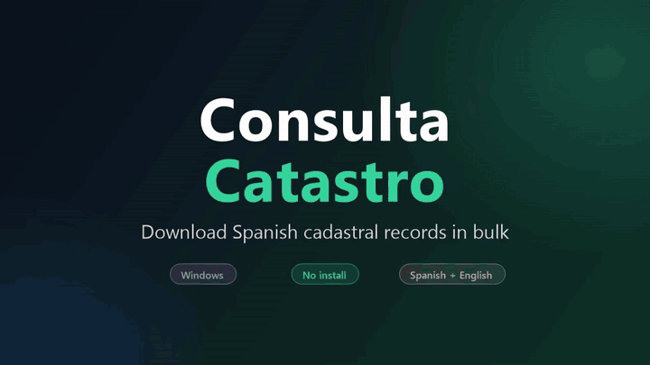

# ConsultaCatastro

This project was fully generated with AI: I gave the orders and prompts, and I reviewed the result. / Este proyecto está generado íntegramente con IA: yo di las órdenes e indicaciones y revisé el resultado.

[Full video (MP4)](assets/demo.mp4)

[English](#english) | [Español](#espanol)

## English

Tiny Windows tool to bulk-download Spanish cadastral records. For each property it saves the PDF record ("Consulta Descriptiva y Gráfica") and creates an Excel summary.

**Requirements:** Windows with PowerShell 5.1 (included in Windows 10/11). Nothing to install. Excel is not needed to create the summary.

### Use
1. Double-click `ConsultaCatastro.bat`.
2. Pick the language (top right). It follows your Windows language by default.
3. Add properties:
   - **By parcel** tab: province, municipality, polygon, parcel, then **Add**.
   - **By cadastral reference** tab: the 20-character code, then **Add**.
4. Remove a mistake with **Remove selected**. Choose the destination folder if you want (default: Documents).
5. Click **Download records**. When it finishes you can open the results folder.

### Output
A new folder `Catastro_<date>_<time>` containing:
- `Catastro.html`: open it in a browser for an index of all properties, with search, filters and links.
- `Summary.xlsx` (`Resumen.xlsx` in Spanish): the main data and the status of each row.
- One sub-folder per property, named after its cadastral reference, with the PDF record, `Croquis.png` (the parcel drawing), a `Consulta.html` page with all its data, and two internet shortcuts (cadastral map and record data).

The HTML pages load Tailwind CSS and Alpine.js from a CDN, so they need an internet connection to look right.

### Files
Keep `ConsultaCatastro.bat`, `ConsultaCatastro.ps1` and the `src` folder together; the script loads its code and page templates from `src`.

### Notes
- Only the public Catastro services (`ovc.catastro.meh.es`, `www1.sedecatastro.gob.es`) are contacted. Nothing else is sent anywhere and no data is stored outside the results folder.
- Requests are sequential, with retries and a short pause. If the service blocks you, the row shows an error; wait and try again.
- If a municipality is not found it is reported as an error and never changed automatically. Check the name (accents are tried both ways).
- If Windows SmartScreen warns about the `.bat`, choose *More info > Run anyway*.
- Data comes from the public Catastro services and has no legal value; use the official certificate for that.

## Español

Pequeña herramienta para Windows que descarga fichas catastrales en bloque. Por cada propiedad guarda el PDF de la ficha ("Consulta Descriptiva y Gráfica") y crea un resumen en Excel.

**Requisitos:** Windows con PowerShell 5.1 (incluido en Windows 10/11). No hay que instalar nada. No hace falta Excel para crear el resumen.

### Uso
1. Haz doble clic en `ConsultaCatastro.bat`.
2. Elige el idioma (arriba a la derecha). Por defecto sigue el idioma de Windows.
3. Añade propiedades:
   - Pestaña **Por parcela**: provincia, municipio, polígono, parcela y **Añadir**.
   - Pestaña **Por referencia catastral**: el código de 20 caracteres y **Añadir**.
4. Si te equivocas, usa **Quitar seleccionada**. Puedes cambiar la carpeta de destino (por defecto: Documentos).
5. Pulsa **Descargar fichas**. Al terminar podrás abrir la carpeta con los resultados.

### Resultado
Una carpeta nueva `Catastro_<fecha>_<hora>` con:
- `Catastro.html`: ábrelo en el navegador para ver un índice de todas las propiedades, con búsqueda, filtros y enlaces.
- `Resumen.xlsx` (`Summary.xlsx` en inglés): los datos principales y el estado de cada fila.
- Una subcarpeta por propiedad, con su referencia catastral como nombre, que contiene la ficha en PDF, `Croquis.png` (el dibujo de la parcela), una página `Consulta.html` con todos sus datos y dos accesos directos de internet (mapa catastral y datos de la ficha).

Las páginas HTML cargan Tailwind CSS y Alpine.js desde un CDN, así que necesitan internet para verse bien.

### Archivos
Mantén juntos `ConsultaCatastro.bat`, `ConsultaCatastro.ps1` y la carpeta `src`; el script carga de ahí su código y las plantillas de las páginas.

### Notas
- Solo se contacta con los servicios públicos del Catastro (`ovc.catastro.meh.es`, `www1.sedecatastro.gob.es`). No se envía nada a otro sitio ni se guardan datos fuera de la carpeta de resultados.
- Las consultas son secuenciales, con reintentos y una pausa corta. Si el servicio te bloquea, la fila mostrará un error; espera y vuelve a intentarlo.
- Si un municipio no se encuentra, se indica como error y nunca se cambia automáticamente. Revisa el nombre (se prueba con y sin acentos).
- Si Windows SmartScreen avisa sobre el `.bat`, elige *Más información > Ejecutar de todas formas*.
- Los datos proceden de los servicios públicos del Catastro y no tienen valor legal; para eso usa el certificado oficial.
